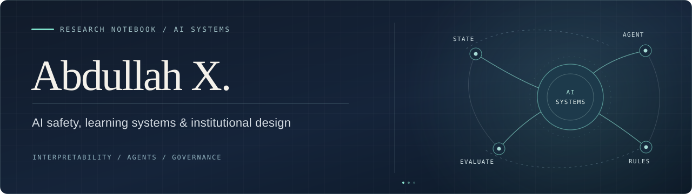

  

  <a href="https://www.projectawareai.org/research/">Research</a>
  &nbsp;·&nbsp;
  <a href="#selected-preprints">Preprints</a>
  &nbsp;·&nbsp;
  <a href="https://github.com/abdullah-x-bd?tab=repositories">Open-source work</a>
  &nbsp;·&nbsp;
  <a href="https://www.projectawareai.org/">Project AWARE</a>

 

### About

I study the safety of AI systems at three levels: **what models represent**, **how agents act**, and **which rules hold when those agents operate inside institutions**.

My work combines controlled experiments, mechanistic interpretability, reproducible systems research, and questions from economics and governance. I am especially interested in the gap between *a system appearing safe* and *having evidence that explains when and why it is safe*.

I founded [**Project AWARE**](https://www.projectawareai.org/), a New Delhi-based think tank working on institutional AI safety through research, diplomacy, and capacity building.

 

### Research directions

| 01 / MODEL INTERNALS | 02 / AGENT BEHAVIOUR | 03 / INSTITUTIONAL DESIGN |
| :--- | :--- | :--- |
| State abstractions, causal interventions, machine unlearning | Controlled evaluations, failure modes, behavioural robustness | Multi-agent governance, authority, oversight and incentives |

 

### Selected work

RESEARCH ARTIFACTS · EXPERIMENTAL SYSTEMS · REPRODUCIBILITY

<table>
  <tr>
    <td width="50%" valign="top">
      01 / MECHANISTIC INTERPRETABILITY
      <h3><a href="https://github.com/abdullah-x-bd/markovian-circuit-tracing">Markovian Circuit Tracing</a></h3>
      
When can transformer activations be understood as a system of latent states and transitions? A ground-truth HMM benchmark tests state recovery and causal interventions, including where the abstraction fails.

      
<a href="https://github.com/abdullah-x-bd/markovian-circuit-tracing">Code &amp; results ↗</a> · <a href="https://arxiv.org/abs/2605.20824">Preprint ↗</a>

    </td>
    <td width="50%" valign="top">
      02 / MACHINE UNLEARNING
      <h3><a href="https://github.com/abdullah-x-bd/unlearning">Unlearning at Scale</a></h3>
      
Reconstructing data-deletion counterfactuals through deterministic, trace-preserving training replay. Experiments separate exact model-state reconstruction from behavioural forgetting.

      
<a href="https://github.com/abdullah-x-bd/unlearning">Code &amp; results ↗</a> · <a href="https://arxiv.org/abs/2508.12220">Preprint ↗</a>

    </td>
  </tr>
  <tr>
    <td width="50%" valign="top">
      03 / MULTI-AGENT SAFETY
      <h3><a href="https://github.com/abdullah-x-bd/polis">POLIS</a></h3>
      
An experimental testbed for algorithmic institutions. Studies how delegated authority, executable guards, provenance and shared-resource rules change agent outcomes.

      
<a href="https://github.com/abdullah-x-bd/polis">Code &amp; evidence ↗</a> · <a href="https://arxiv.org/abs/2608.09828">Preprint ↗</a>

    </td>
    <td width="50%" valign="top">
      04 / AGENT EVALUATION
      <h3><a href="https://github.com/abdullah-x-bd/SafeguardShift">SafeguardShift</a></h3>
      
Evaluates agent behaviour when verification, review, monitoring, authority or other institutional safeguards are removed. Separates what agents attempt from what environments permit.

      
<a href="https://github.com/abdullah-x-bd/SafeguardShift">Benchmark &amp; findings ↗</a>

    </td>
  </tr>
  <tr>
    <td width="50%" valign="top">
      05 / RELIABLE ML SYSTEMS
      <h3><a href="https://github.com/abdullah-x-bd/PipelineProof">PipelineProof</a></h3>
      
An execution-based benchmark for detecting and repairing silent failures in ML pipelines, from leakage to incorrect evaluation, with held-back verification.

      
<a href="https://github.com/abdullah-x-bd/PipelineProof">Benchmark &amp; verifier ↗</a>

    </td>
    <td width="50%" valign="top">
      06 / AI &amp; SOCIAL MEASUREMENT
      <h3><a href="https://github.com/abdullah-x-bd/LLM_Persona">Synthetic Individuals, Synthetic Populations</a></h3>
      
Tests whether improvements in LLM-based individual simulation translate into better population estimates. Individual accuracy and population fidelity need not move together.

      
<a href="https://github.com/abdullah-x-bd/LLM_Persona">Study &amp; analysis ↗</a>

    </td>
  </tr>
</table>

**Other applied systems** &nbsp; [OpenVQ](https://github.com/abdullah-x-bd/openvq), an interpretable speech-quality research engine · [ICR-OPT](https://github.com/abdullah-x-bd/icr-sim), a geospatial and economic model of mobile network sharing.

 

### Selected preprints

| Year | Manuscript | Links |
| :--- | :--- | :--- |
| 2026 | **Markovian Circuit Tracing for Transformer State Dynamics** | [arXiv](https://arxiv.org/abs/2605.20824) · [Artifact](https://github.com/abdullah-x-bd/markovian-circuit-tracing) |
| 2026 | **Multi-Agent AI Safety as an Institutional Design Problem** | [arXiv](https://arxiv.org/abs/2608.09828) · [Artifact](https://github.com/abdullah-x-bd/polis) |
| 2025 | **Unlearning at Scale: Implementing the Right to be Forgotten in Large Language Models** | [arXiv](https://arxiv.org/abs/2508.12220) · [Artifact](https://github.com/abdullah-x-bd/unlearning) |

These are research preprints. Repository documentation records the methods, results and limits of the corresponding experimental artifacts.

 

### Research practice

**Ground truth when possible. Counterfactuals when useful. Negative results when warranted.**

I aim to make evaluation protocols, code, assumptions and claim boundaries inspectable. Several repositories deliberately retain failed controls and limitations alongside positive findings.

---

  NEW DELHI, INDIA &nbsp;·&nbsp; AI SAFETY RESEARCH &nbsp;·&nbsp; <a href="https://www.projectawareai.org/">PROJECT AWARE</a>

